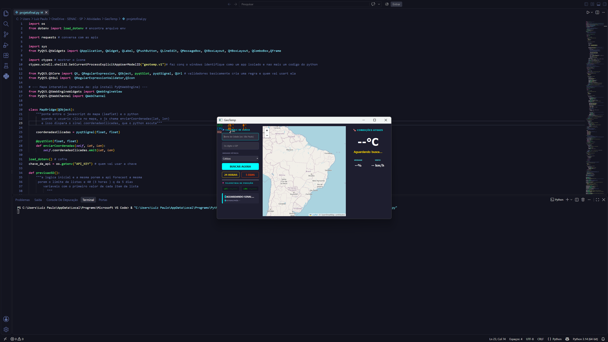
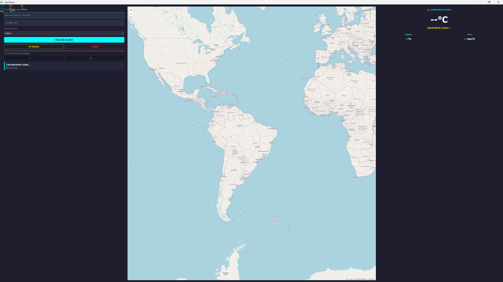

[🇧🇷 Português](README.md) | [🇺🇸 English](README.en.md)

# 🌍 GeoTemp — Real-Time Weather

Dark-themed desktop app with a control-panel style interface that shows the current temperature, a 24-hour forecast and a weekly forecast for any city. You can search by city name, ZIP code (CEP), or by clicking directly on the interactive map.

> 🚧 Work in progress — core features implemented, interactive map added, visual improvements under development.

---

## ⚡ Features

| Feature | Description |
|---|---|
| Current temperature | Real-time weather: temperature, description, humidity and wind |
| 24-hour forecast | Table in 3-hour intervals showing temperature, weather and wind |
| 5-day forecast | Report with daily minimum and maximum |
| Search by city or ZIP code | Accepts a city name or CEP, converted automatically via ViaCEP |
| **Interactive map** | Click anywhere on the map (Leaflet) to automatically fetch the temperature for that location |
| Double validation | If both city and CEP are provided, checks that the CEP belongs to that city |
| Temperature unit | Celsius, Fahrenheit or Kelvin, selectable in the interface |
| Position telemetry | Shows the latitude and longitude of the searched city |

<p align="center">
  
  
</p>

---

## 🛠️ Technologies

- Language: **Python 3**
- Interface: **PyQt5** + **PyQtWebEngine** (interactive map)
- Map: **Leaflet.js** running inside a `QWebEngineView`, communicating with Python via `QWebChannel`
- APIs: **OpenWeatherMap** (weather, geocoding and reverse geocoding) · **ViaCEP** (CEP lookup)
- Security: **.env** file to protect the API key (first time using environment variables)
- Version control: **.gitignore** configured so the key is not exposed on GitHub

---

## 🗺️ Interactive map

The central panel now shows a world map (OpenStreetMap via Leaflet). When you click anywhere:

1. The map's JavaScript captures the latitude and longitude of the click
2. These coordinates are sent to Python through a `QWebChannel`
3. The app performs a reverse geocoding lookup to find the place name
4. The current temperature at that point is fetched and displayed automatically

---

## 🔐 First time with .env and .gitignore

This project marks the first time I used security best practices:

- The API key lives in the `.env` file and never appears in the code
- `.gitignore` prevents `.env` from being pushed to GitHub
- The repository includes a `.env.exemplo` file showing which variables are required

---

## ⚙️ How to run

<details>
<summary>🔑 Set up the API key</summary>

Create a free account at [openweathermap.org](https://openweathermap.org/api) and generate your API key.

Rename the `.env.exemplo` file to `.env` and paste your key:

```
API_KEY=your_key_here
```

</details>

<details>
<summary>📥 Install and run</summary>

### 1. Install the dependencies
```bash
pip install PyQt5 PyQtWebEngine requests python-dotenv
```

### 2. Set up the .env file (see above)

### 3. Run
```bash
python projetofinal.py
```

</details>

<details>
<summary>🔀 Clone the repository</summary>

### 1. Clone
```bash
git clone https://github.com/LuizPauloSoares/GeoTemp.git
```

### 2. Enter the folder
```bash
cd GeoTemp
```

### 3. Install the dependencies
```bash
pip install PyQt5 PyQtWebEngine requests python-dotenv
```

### 4. Set up the .env file and run
```bash
python projetofinal.py
```

</details>

---

## 👤 Author

**Luiz Paulo Soares**  
Back-end developer | Python · Java · SQL Server  
[](https://linkedin.com/in/luiz-paulo-soares)
[](https://github.com/LuizPauloSoares)
